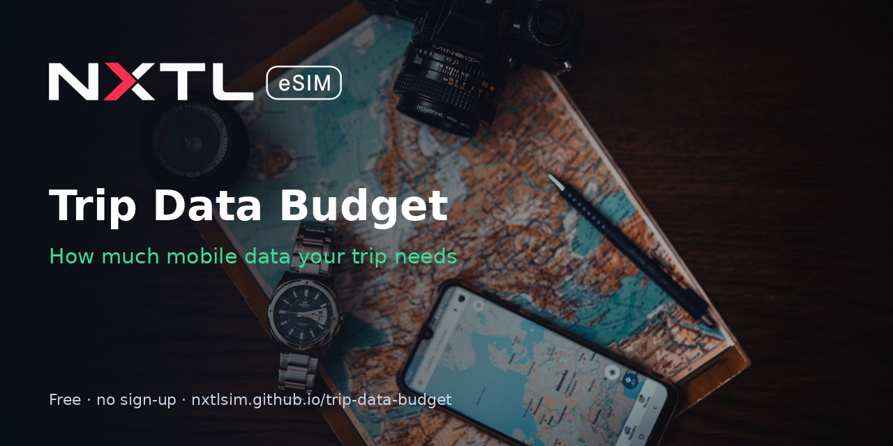

# Trip Data Budget Planner

**Live app:** https://nxtlsim.github.io/trip-data-budget/

How much mobile data do you need for a trip? Pick destinations and days, choose a usage preset (Light, Normal, Heavy, Remote work) or set hours per activity, and get a per-day and per-trip MB/GB estimate. Every assumption is shown in a table. Works on phone and desktop and installs as an app (PWA). No sign-up, no trackers, and results are shareable by URL.

## How it works
- **Location prefill:** the approximate country comes from NXTL's public, IP-based `geo/country` endpoint, with no permission prompt. If that fails, it falls back to the browser language region. Nothing is stored.
- **Estimates:** MB per hour per activity are rounded estimates, not measurements, plus a 10% buffer for background use. Edit them in `docs/index.html` (`ACTS`).
- **Cost line:** shows the cost at the NXTL pay-as-you-go rate for each country, using the Cheapest-network rate, which is the default setting. Rates load live from the public endpoint `https://nxtlsim.com/wp-json/nxtl-app/v1/pricing/countries`, which allows CORS from this site. If it can't be reached, the app uses the bundled `docs/rates.json` snapshot (checked 2026-10-26). Current prices: https://nxtlsim.com/pricing/

## Share links
`?d=Turkey:7,Japan:5&p=normal`, or custom hours: `&h=maps:1,social:2`

## Files
`docs/` index.html, manifest.json, sw.js, rates.json, icon-192.png, icon-512.png

MIT licence. Built by [NXTL eSIM](https://nxtlsim.com/?utm_source=github&utm_medium=readme&utm_campaign=trip-data-budget). Cover photo: Vojta Kovařík on Pexels.
